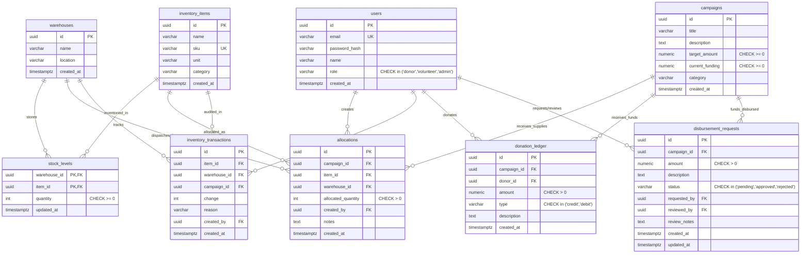

# GiveTrack | Non-Profit Operations & Cryptographic Ledger Platform

[](https://nextjs.org/)
[](https://www.postgresql.org/)
[](https://www.docker.com/)
[](https://www.typescriptlang.org/)
[](https://tailwindcss.com/)

> **GiveTrack** is a portfolio-grade non-profit operations platform demonstrating database engineering in PostgreSQL and server-side RBAC in Next.js 14. It unifies real-time physical inventory supply chains across regional distribution hubs with an immutable, transparent donation ledger.

---

## 📑 Table of Contents
1. [Architecture Overview](#-architecture-overview)
2. [Entity-Relationship (ER) Diagram](#-entity-relationship-er-diagram)
3. [Technical Highlights (Engineering Showcase)](#-technical-highlights-engineering-showcase)
   - [1. Real Database Constraints & Negative Stock Prevention](#1-real-database-constraints--negative-stock-prevention)
   - [2. Pessimistic Row Locking & Deadlock-Free Transfers](#2-pessimistic-row-locking--deadlock-free-transfers)
   - [3. Immutable Ledger Triggers & Automated Balance Sync](#3-immutable-ledger-triggers--automated-balance-sync)
   - [4. High-Performance SQL Window Functions](#4-high-performance-sql-window-functions)
   - [5. Edge RBAC & Server-Side Defense in Depth](#5-edge-rbac--server-side-defense-in-depth)
4. [Quick Start with Docker](#-quick-start-with-docker-recommended)
5. [Local Development Setup](#-local-development-setup)
6. [Automated Concurrency Stress Testing](#-automated-concurrency-stress-testing)
7. [Demo Accounts & Role Credentials](#-demo-accounts--role-credentials)
8. [Docker Multi-Stage Build & Image Size](#-docker-multi-stage-build--image-size)

---

## 🏛 Architecture Overview

```
                      ┌────────────────────────────────────────┐
                      │          Client Browser / UI           │
                      │  Next.js 14 App Router (Tailwind CSS)  │
                      └───────────────────┬────────────────────┘
                                          │
                                   HTTP / Cookies
                                          │
                      ┌───────────────────▼────────────────────┐
                      │        Edge Next.js Middleware         │
                      │    Cryptographic jose JWT Validation   │
                      └───────────────────┬────────────────────┘
                                          │
                 ┌────────────────────────┼────────────────────────┐
                 │                        │                        │
       ┌─────────▼────────┐     ┌─────────▼────────┐     ┌─────────▼────────┐
       │   /dashboard/*   │     │   /volunteer/*   │     │     /admin/*     │
       │    Donor Role    │     │  Volunteer/Admin │     │    Admin Role    │
       └─────────┬────────┘     └─────────┬────────┘     └─────────┬────────┘
                 │                        │                        │
                 └────────────────────────┼────────────────────────┘
                                          │
                      ┌───────────────────▼────────────────────┐
                      │      Server Actions & Route Handlers   │
                      │  Defense-in-Depth RBAC & Zod Validation│
                      └───────────────────┬────────────────────┘
                                          │
                                 node-postgres (pg)
                           Raw Parameterized SQL Pool
                                          │
                      ┌───────────────────▼────────────────────┐
                      │        PostgreSQL 16 Engine            │
                      │ ├─ Constraints: CHECK (qty >= 0)       │
                      │ ├─ Transactions: SELECT ... FOR UPDATE │
                      │ ├─ Triggers: BEFORE UPDATE OR DELETE   │
                      │ └─ Window Func: SUM() OVER (...)       │
                      └────────────────────────────────────────┘
```

---

## 🗄 Entity-Relationship (ER) Diagram



---

## 🚀 Technical Highlights (Engineering Showcase)

### 1. Real Database Constraints & Negative Stock Prevention
In high-throughput logistics software, application-level checks alone are vulnerable to race conditions. GiveTrack establishes database-level mathematical invariants:
* In `stock_levels`: `quantity INT NOT NULL CHECK (quantity >= 0)`.
* In `campaigns`: `current_funding NUMERIC(12,2) NOT NULL DEFAULT 0.00 CHECK (current_funding >= 0)`.
* In `donation_ledger`: `amount NUMERIC(12,2) NOT NULL CHECK (amount > 0)`.
Even if application business logic had a concurrency flaw, PostgreSQL will abort the transaction with code `23514` (Check Violation) before negative inventory or negative balance can ever be persisted.

### 2. Pessimistic Row Locking & Deadlock-Free Transfers
When executing `allocateStock()`, the operation runs inside an isolated PostgreSQL transaction using **pessimistic row-level locking**:
```sql
SELECT quantity FROM stock_levels
WHERE warehouse_id = $1 AND item_id = $2
FOR UPDATE;
```
For `transferStock()` across two warehouses, naive concurrent locking causes deadlocks if Warehouse A transfers to B while B transfers to A simultaneously. GiveTrack solves this by sorting warehouse lock acquisitions deterministically:
```sql
SELECT warehouse_id, quantity FROM stock_levels
WHERE item_id = $1 AND warehouse_id IN ($2, $3)
ORDER BY warehouse_id ASC
FOR UPDATE;
```

### 3. Immutable Ledger Triggers & Automated Balance Sync
Financial ledgers must be tamper-proof and append-only:
* An event trigger `prevent_donation_ledger_modification` intercepts any `UPDATE` or `DELETE` on `donation_ledger` and raises a PostgreSQL exception. Corrections require reversing credit/debit entries.
* An `AFTER INSERT` trigger `sync_campaign_funding_from_ledger` automatically adds credits and subtracts debits from `campaigns.current_funding`. If an admin-approved debit exceeds campaign funding, the `CHECK (current_funding >= 0)` constraint triggers a rollback across the entire transaction.

### 4. High-Performance SQL Window Functions
Instead of querying all historical transactions into Node.js and calculating rolling totals in memory, running balances are calculated directly inside the query planner using SQL window functions:
```sql
SELECT 
  dl.id,
  dl.campaign_id,
  dl.amount,
  dl.type,
  dl.description,
  dl.created_at,
  SUM(CASE WHEN dl.type = 'credit' THEN dl.amount ELSE -dl.amount END) 
    OVER (
      PARTITION BY dl.campaign_id 
      ORDER BY dl.created_at ASC, dl.id ASC
    ) AS running_balance
FROM donation_ledger dl
WHERE dl.campaign_id = $1
ORDER BY dl.created_at DESC, dl.id DESC;
```
A composite index on `(campaign_id, created_at, id)` allows PostgreSQL to evaluate partition boundaries and cumulative sums with zero disk sorting.

### 5. Edge RBAC & Server-Side Defense in Depth
GiveTrack implements security in layers:
1. **Edge Middleware (`middleware.ts`)**: Cryptographically verifies the `jose` JWT in Edge runtime before routes render, redirecting unauthenticated users to `/login` and wrong roles to `/403`.
2. **Server-Side Defense in Depth (`lib/rbac.ts`)**: Every Server Action and Route Handler re-checks the session identity directly from secure cookies. No client-supplied role payloads are ever trusted.

---

## 🐳 Quick Start with Docker (Recommended)

Run the entire platform with one command (no local Node or Postgres required):

```bash
docker compose up --build
```

This automatically:
1. Spins up PostgreSQL 16 on alpine with healthchecks.
2. Runs the idempotent migration runner applying migrations `001` through `006`.
3. Seeds realistic demo data (users, warehouses, stock, campaigns, 25+ ledger entries).
4. Launches the Next.js standalone container at **`http://localhost:3000`**.

---

## 💻 Local Development Setup

To run locally without Docker:

```bash
# 1. Install dependencies
npm install

# 2. Copy and configure environment variables
cp .env.example .env

# 3. Apply database migrations
npm run db:migrate

# 4. Seed demo dataset
npm run db:seed

# 5. Start Next.js development server
npm run dev
```

Visit [http://localhost:3000](http://localhost:3000).

---

## 🧪 Automated Concurrency Stress Testing

Prove row-locking and constraint safety under simulated concurrent load:

```bash
# Via Docker:
docker compose --profile test run --rm test

# Or locally:
npm run test:concurrency
```

**Test Methodology:**
* Fixture creates an item with **50 units**.
* Fires **20 concurrent parallel workers**, each demanding **10 units** (200 total demand).
* **Guaranteed Result**: Exactly 5 requests succeed, exactly 15 fail with `InsufficientStockError`, final stock is exactly `0`, and stock never dips below zero at any point.

---

## 🔑 Demo Accounts & Role Credentials

The login page features 1-click role switcher buttons for quick testing:

| Role | Email | Password | Allowed Capabilities |
| :--- | :--- | :--- | :--- |
| **Admin** | `admin@givetrack.org` | `Password123!` | Approve/reject financial debits, launch campaigns, view full system audit |
| **Volunteer** | `volunteer@givetrack.org` | `Password123!` | Allocate physical stock to campaigns, inter-warehouse transfers, submit disbursements |
| **Donor** | `donor@givetrack.org` | `Password123!` | View tax receipts, trace personal contributions to specific field allocations |

---

## 📦 Docker Multi-Stage Build & Image Size

The production Dockerfile uses a 3-stage build (`deps` $\rightarrow$ `builder` $\rightarrow$ `runner`) with `output: 'standalone'` in Next.js:

* **Base OS**: Alpine Linux (`node:20-alpine`)
* **Security**: Non-root system user (`nextjs:nodejs`, UID 1001)
* **Healthcheck**: Active HTTP probe hitting `/api/health` (executing `SELECT 1` on DB)
* **Estimated Final Image Size**: **~145 MB** (excludes `node_modules` dev dependencies, TypeScript compiler, and build cache).
